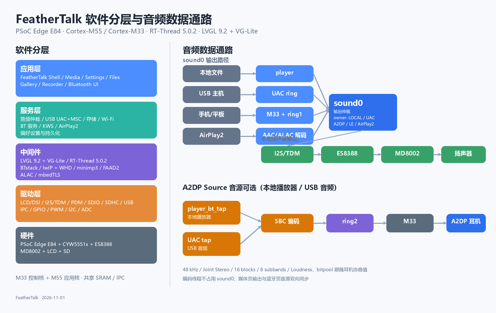

# 【2026嵌入式大赛】FeatherTalk：基于 PSoC Edge E84 的双核智能音频终端

> **关键词**：PSoC Edge E84、Cortex-M55 + Cortex-M33、RT-Thread、LVGL 9.2、VG-Lite、A2DP、LE Audio、Auracast、USB UAC、Wi-Fi、KWS、Ethos-U55
>
> **发布前请处理两处占位**：把 `REPO_URL` 替换为项目仓库地址（建议带 `product/edgi-talk` 分支路径），并在标记“图片待粘贴”的位置插入图片。

FeatherTalk 是一套运行在 Edgi-Talk PSoC Edge E84 开发板上的双核综合 Demo。项目以 RT-Thread 为系统底座，把 Cortex-M55 与 Cortex-M33 双核、LVGL 9.2 + VG-Lite 图形管线、经典蓝牙、LE Audio、Auracast、USB 音频、Wi-Fi、本地唤醒词和 Ethos-U55 NPU 基准整合到同一套固件中。

它不是单个外设或单个协议栈的示例，而是尝试回答一个产品化问题：**在一块 MCU 上，如何让复杂 UI、实时音频、无线协议栈、USB、存储和本地 AI 同时工作，并且可构建、可烧录、可诊断。**

> 图片 1：整机与开发环境照片（发布时粘贴）

## 一、项目概述

### 1.1 背景与目标

端侧智能音频设备需要同时处理触摸交互、音频播放与录音、蓝牙连接、USB 音频、文件系统、无线网络和本地 AI。PSoC Edge E84 提供了双核处理器、GPU、NPU、显示控制器和丰富外设，但官方资料多以单个外设或中间件示例为主，缺少一个能体现完整产品形态的参考工程。

FeatherTalk 的目标是建立一套**可运行的双核综合 Demo + 面向产品化的架构验证平台**：

- 验证 M33/M55 双核分工、跨核 IPC 和共享内存设计；
- 验证显示、音频、USB、存储和无线在有限 SRAM/HyperRAM/总线带宽下的协同；
- 形成可重复的双核构建、签名、烧录、串口和测试工具链；
- 为后续真实产品提供清晰的模块边界和验收清单。

### 1.2 主要成果

- 一套可启动、可交互、可烧录的 M33/M55 综合固件；
- 21 个 UI 页面、32 个可重复基准场景；
- 支持 WAV/MP3 的本地音乐播放器，包含 3D 封面流、专辑图和扬声器/蓝牙输出切换；
- 经典蓝牙 A2DP Sink/Source、LE Audio 单播、Auracast 广播源、配对持久化和扫描/连接 UI；
- 双向 USB UAC、USB MSC、USB 到蓝牙转发；
- Wi-Fi 扫描/连接、TCP 诊断和 AirPlay2 研究原型；
- 本地“小麦小麦”唤醒词全链路和 Ethos-U55 带宽基准；
- 完整的构建、烧录、串口和测试脚本。

> 图片 2：FeatherTalk 桌面与音乐播放器 3D 封面流（发布时粘贴）

## 二、功能介绍

| 功能模块 | 已实现能力 |
| --- | --- |
| 桌面与系统交互 | 480×800 触摸 UI；中英文自适应；桌面、应用列表、通知栏、全局搜索、设置和多级子页面；主题色、壁纸、时间格式、时区、语言和亮度持久化 |
| 音乐播放器 | SD/Flash 文件夹播放列表；WAV/MP3；3D Cover Flow、专辑图、倒影；播放/暂停/切歌/进度/音量/循环；输出设备可选板载扬声器或蓝牙耳机 |
| 录音、文件与图库 | PDM 麦克风录音生成 WAV；文件目录浏览、复制/粘贴、重命名、删除、格式化；图库预览、全屏查看、设为壁纸 |
| 蓝牙音频 | 经典蓝牙配对与 link key 持久化；A2DP Sink/Source；扫描结果列表、设备名/MAC/连接标记；A2DP Source 音源可选 USB 音频或本地播放器；LE Audio 单播；Auracast 广播源 |
| USB 音频与存储 | USB UAC 扬声器与麦克风、动态格式协商与时钟漂移校准、USB MSC、USB 到蓝牙转发 |
| Wi-Fi 与 AirPlay2 | CYW5551x Wi-Fi 扫描/连接、TCP/IP；AirPlay2 研究原型：mDNS、RTSP/HTTP、HAP transient 配对、会话/RTP 加密、ALAC/AAC-LC、`sound0` 输出 |
| 本地语音唤醒与 NPU | “小麦小麦”唤醒词、PDM 滑窗推理、开机自启、M33 事件联动和 LED；Ethos-U55 权重读带宽基准与模型生成工具 |
| 开发与诊断 | M55 产品 Shell、M33 UART5 诊断终端、UI 场景切换、GPU/刷新/scanout/堆统计、音频/蓝牙专项命令、双核构建与烧录脚本 |

> 图片 3：音乐播放器与输出设备选择（发布时粘贴）
>
> 图片 4：蓝牙设置页扫描列表与音源选择（发布时粘贴）

### 当前功能边界

- AirPlay2 是**研究原型**，协议和模拟网络音频测试已通过，真实 iPhone 连续播放、PTP 同步和长时间验收尚未完成。
- 本地播放器到 A2DP Source 的编码、协商和输出切换路径已打通，真实耳机的长时试听仍在复测。
- Ethos-U55 当前是数据通路和带宽测量工具，不代表本地大模型推理已经完成。
- 自研底板、USB+PMU 子板和 FPGA/Smart I/O 音频桥是设计资料，未纳入当前综合固件，也不代表已经投产或验证。

## 三、硬件框架说明

### 3.1 板卡与 SoC

当前验证平台为 Edgi-Talk PSoC Edge E84 开发板，采用“核心板 + 底板”结构。核心板搭载 PSoC Edge E84（`PSE846GPS2DBZC4A`，BGA-220）、QSPI NOR、HyperRAM 和音频前端；底板提供 ES8388 Codec、MD8002 功放、CYW5551x 无线模组、MIPI-DSI 显示、SD 卡、CAN、扩展接口和 KitProg3 调试器。

| 模块 | 硬件能力 | FeatherTalk 中的角色 |
| --- | --- | --- |
| Cortex-M55 | 最高 400 MHz；Helium/MVE、DSP、FPU；32 KiB I-Cache、32 KiB D-Cache；256 KiB ITCM/DTCM | RT-Thread、LVGL、应用、显示、文件、USB 和音频主控 |
| Cortex-M33 | 最高 200 MHz；DSP、FPU、TrustZone；16 KiB I-Cache | 安全启动、蓝牙 Host、无线资源管理、M55 启动和跨核服务 |
| Ethos-U55 | 最高 400 MHz；128 MAC/cycle；INT8 峰值 51.2 GOPS | NPU 带宽基准 |
| GPU | GCNano Ultra V，VG-Lite 3.0 接口 | LVGL 2.5D 绘制、封面流、图形合成 |
| 显示控制器 | DC8000Nano + MIPI-DSI | 双 framebuffer direct scanout 到 480×800 面板 |

### 3.2 存储与外设

| 资源 | 容量/连接 | 用途 |
| --- | --- | --- |
| SoCMEM | 5 MiB | 双核共享、GPU/显示、音频 ring 和堆 |
| M33 subsystem SRAM | 1 MiB | M33 私有代码/数据及跨核保留区 |
| M55 ITCM/DTCM | 256 KiB / 256 KiB | 低延迟代码、数据和栈 |
| QSPI NOR | 128 Mbit（16 MiB） | M33/M55 XIP、签名槽和末尾 2 MiB `/flash` |
| HyperRAM | 128 Mbit（16 MiB） | M33/M55 私有区和 12 MiB 共享区 |
| microSD | SDHC1，4-bit | FAT 文件系统，挂载 `/sdcard` |
| LCD | 480×800 RGB565，MIPI-DSI 2 data lanes | 产品 UI |
| Codec/功放 | ES8388 + MD8002 类 2 W AB 功放 | 本地音频输入/输出 |
| 数字麦克风 | 2 路 PDM MEMS | 录音、UAC 麦克风、KWS |
| Wi-Fi/Bluetooth | CYW5551x 组合模组 | Wi-Fi SDIO、蓝牙 UART + Wake/Reset |
| USB | USB 2.0 HS/FS PHY | UAC + MSC |
| 调试 | 板载 KitProg3、SWD/JTAG、调试 UART | 构建、烧录和诊断 |

### 3.3 硬件数据通路

```text
                        +---------------------------------------------+
                        |          PSoC Edge E84 (BGA-220)            |
                        |  Cortex-M55 400 MHz | Cortex-M33 200 MHz  |
                        |  Ethos-U55 | GCNano Ultra V | DC8000Nano   |
                        +----+-------------+-------------+------------+
                             |             |             |
                        MIPI-DSI       I2S/TDM       SDIO / UART
                             |             |             |
                       480x800 LCD    ES8388 Codec   CYW5551x Wi-Fi/BT
                                       + MD8002 amp
                             |             |             |
                        Touch I2C      Speaker       Wi-Fi / Classic BT
                                                       LE Audio / Auracast

                        QSPI NOR 16 MiB  +  HyperRAM 16 MiB  +  microSD
```

- **显示**：LVGL 渲染到 RGB565 framebuffer → DC8000Nano 读取 → MIPI-DSI → 480×800 面板。
- **音频输出**：本地文件/UAC/A2DP Sink/LE Audio/AirPlay2 → `sound0` → I2S/TDM → ES8388 → MD8002 → 扬声器。
- **音频上行**：PDM 麦克风 → M55 录音/UAC 麦克风 → USB 主机或 WAV 文件。
- **蓝牙音频**：M33 BTstack ↔ HCI UART ↔ CYW5551x；A2DP/LE Audio 帧通过共享 SRAM ring 与 M55 交换。
- **Wi-Fi**：M55 WHD + lwIP ↔ SDIO ↔ CYW5551x。

> 图片 5：核心板/底板与硬件框图（发布时粘贴）

## 四、软件框架说明

### 4.1 双核分工

| 模块 | M33 控制核 | M55 应用核 |
| --- | --- | --- |
| 系统 | 板级初始化、启动 M55、版本与状态监督 | 产品应用、界面和主要业务服务 |
| 无线 | BTstack、经典蓝牙、BLE、LE Audio、Auracast、HCI UART | WHD、lwIP、Wi-Fi 扫描/连接、AirPlay2 |
| 音频 | A2DP/ISO 数据收发、跨核音频生产或消费 | SBC/LC3/AAC/ALAC 处理、播放、录音、`sound0` 输出 |
| 用户功能 | 蓝牙状态与控制命令 | LVGL、USB UAC/MSC、文件系统、图库、设置和持久化 |
| 共享资源 | Radio Manager 的蓝牙所有者 | Radio Manager 的 Wi-Fi 所有者 |

### 4.2 启动链

```text
Secure M33
  安全启动、签名镜像与启动策略
        |
        v
M33 Non-Secure / RT-Thread
  板级初始化 -> 启动 M55 -> 蓝牙 Host / Radio Manager / IPC
        |
        +---------------- IPC Pipe + 共享 SRAM ----------------+
        |                                                      |
        v                                                      v
M55 / RT-Thread                                      CYW5551x 无线模组
  LVGL / Wi-Fi / USB / 存储 / 音频 / AirPlay2         Wi-Fi: M55 WHD + SDIO
                                                     蓝牙: M33 BTstack + HCI UART
```

更新双核固件时，先烧写 M55，再烧写包含 Secure M33 的签名 M33 合并镜像，最后一次 M33 复位完成启动链并释放 M55。

### 4.3 软件分层

```text
+-----------------------------------------------------------------------+
| 应用层   FeatherTalk Shell / Media / Settings / Files / Gallery /     |
|          Recorder / Bluetooth UI / System pages                       |
+-----------------------------------------------------------------------+
| 服务层   音频仲裁 / USB UAC+MSC / 存储 / Wi-Fi / BT 服务 / KWS /      |
|          AirPlay2 / 偏好设置与持久化                                  |
+-----------------------------------------------------------------------+
| 中间件   LVGL 9.2 + VG-Lite / RT-Thread 5.0.2 / BTstack / lwIP + WHD /|
|          minimp3 / FAAD2 / ALAC / mbedTLS 等                          |
+-----------------------------------------------------------------------+
| 驱动层   LCD/DSI / I2S/TDM / PDM / SDIO / SDHC / USB / IPC / GPIO /   |
|          PWM / I2C / ADC                                              |
+-----------------------------------------------------------------------+
| 硬件     PSoC Edge E84 + CYW5551x + ES8388 + MD8002 + LCD + SD        |
+-----------------------------------------------------------------------+
```

### 4.4 音频架构

**输出仲裁**：本地扬声器播放、UAC、A2DP Sink、LE Audio 和 AirPlay2 通过 owner 机制竞争 `sound0`，避免多个音源无约束同时输出。

```text
本地文件 ──► player ──┬─► sound0 ──► I2S/TDM ──► ES8388 ──► 扬声器
                     └─► player_bt_tap ──► SBC 编码 ──► ring2 ──► M33 ──► A2DP 耳机

USB 主机 ──► UAC ring ─┬─► sound0 ──► 扬声器
                       └─► UAC tap ──► SBC 编码 ──► ring2 ──► M33 ──► A2DP 耳机

手机/平板 ──► M33 A2DP Sink ──► ring1 ──► SBC 解码 ──► sound0 ──► 扬声器
手机/平板 ──► M33 LE Audio ──► ring1 ──► LC3 解码 ──► sound0 ──► 扬声器
AirPlay2 ──► 网络/RTP ──► AAC/ALAC 解码 ──► sound0 ──► 扬声器
```

**A2DP Source 音源选择**：编码线程从 UAC tap 或本地播放器 tap 二选一，不再默认绑定 USB。媒体页“蓝牙耳机”与蓝牙设置页“音源: 本地”互相同步；USB 转发只静音 UAC 的本地 `sound0` 输出，编码线程本身不占用 `sound0`。编码器固定 48 kHz / Joint Stereo / 16 blocks / 8 subbands / Loudness，bitpool 跟随耳机协商值。

### 4.5 显示与图形管线

- LVGL draw task 整帧收集后编码为 VG-Lite 命令链，正常路径接近每帧一次 GPU 提交。
- 双 RGB565 framebuffer 同时用于 LVGL 渲染和 DC scanout，避免额外整帧复制。
- VG-Lite、刷新、字体等热代码放入 M55 ITCM，冷页面和业务代码留在外部 XIP。
- 提供 GPU、刷新、scanout、堆和页面状态诊断，支持 60 帧全屏基准。

### 4.6 无线、存储与工具链

- **经典蓝牙 / BLE / LE Audio / Auracast**：M33 上的 BTstack 产品适配，HCI 通过 UART 与 CYW5551x 通信。
- **Wi-Fi**：M55 上的 WHD + lwIP，经 SDIO 与同一模组通信。
- **无线共存**：Wi-Fi 与蓝牙独立 claim、独立复位和错误计数；A2DP、LE Audio 单播和 Auracast 之间按音频路径互斥。
- **存储**：QSPI NOR 末尾 2 MiB `/flash` 用户盘 + microSD `/sdcard`；文件操作支持浏览、复制/粘贴、重命名、删除和格式化；USB MSC 可暴露给 PC。
- **工具链**：`build-demo.cmd` 完成双核构建和签名合并，`flash-feathertalk.cmd` 完成 M55 → M33 烧录校验，`serial-monitor.cmd` 提供串口监控；`tools/freather/tests` 和 `benchmark-ui-scenes.py` 提供协议、UI、无线和音频测试。



## 五、项目亮点

1. **双核 RT-Thread 产品化**：M33 负责启动、蓝牙、无线资源与跨核服务，M55 负责 UI、音频、USB、存储和 Wi-Fi，职责和接口清晰。
2. **LVGL 9.2 + VG-Lite 整帧批处理**：双 framebuffer 同时承担渲染和 scanout，减少整帧复制，支持 3D 封面流等复杂 UI。
3. **跨核音频数据面**：双向共享 SRAM ring + doorbell，统一承载 SBC/LC3 帧、格式和状态，配合 `sound0` owner 仲裁。
4. **A2DP Source 音源可选**：本地文件和 USB 音频都可以发送到蓝牙耳机，媒体页输出与蓝牙设置页音源双向同步。
5. **无线共存管理**：Wi-Fi 与蓝牙独立 claim、状态、复位和错误计数，普通功能开关不会切断另一功能。
6. **共享 Flash 保护**：M55 擦写用户 Flash 时，跨核守卫避免 M33 继续执行同一 SMIF 设备上的旧缓存代码。
7. **完整工具链**：构建、签名、烧录、串口、UI/GPU 基准和无线/音频测试全部可重复执行。

## 六、开发状态与下一步

当前基线为 **2026-11-01，`product/edgi-talk`**。综合 Demo 已整合一轮，正在进入真实外部设备兼容性与长时间稳定性验收。

已完成的主要工作：

- 双核启动、IPC、共享内存、构建烧录和产品工具链；
- LVGL 产品 Shell、存储、图库、播放、录音和 GPU 优化路径；
- 经典蓝牙 A2DP Sink/Source、LE Audio、Auracast、Wi-Fi、USB 和本地 KWS；
- AirPlay2 研究原型和 Ethos-U55 带宽基准。

最近一轮补充：

- 媒体播放器新增扬声器/蓝牙输出切换，打通本地文件到 A2DP Source 的独立 `player_bt_tap` 通路；
- 蓝牙设置页新增扫描结果列表、已连接设备信息和“音源: USB/本地”切换；
- A2DP Source 能力集与 M55 编码器对齐，SBC bitpool 跟随耳机协商值；
- 补充经典蓝牙远端名称查询，修正 MAC 地址显示字节序。

下一步优先级：

1. 使用真实手机/耳机回归 A2DP、LE Audio、音量控制、断线重连和长时间播放；
2. 使用真实 iOS/macOS 发送端完成 AirPlay2 配对、连续音乐、PTP 同步和断线恢复；
3. 回归 USB UAC/MSC、本地播放、录音、图库和存储持久化；
4. 测量 Wi-Fi 已连接条件下的蓝牙音频并发、吞吐、丢包和长时稳定性；
5. 冻结发布配置并形成完整验收清单。

## 七、演示与代码

- **演示视频**：待补充链接（发布时粘贴视频地址或封面图）。
- **开源代码**：项目仓库（发布时将 `REPO_URL` 替换为实际地址）。

> 图片 7：演示视频封面或二维码（发布时粘贴）

快速体验：

```powershell
.\tools\freather\build-demo.cmd FeatherTalk_M55 -Clean
.\tools\freather\build-demo.cmd FeatherTalk_M33 -Clean
.\tools\freather\flash-feathertalk.cmd
.\tools\freather\serial-monitor.cmd --port COM17 --baud 115200
```

常用调试命令：

```text
feather_ui_status
feather_ui_bench
feather_player status
feather_bt_source status
feather_bt_source input usb|player
ft_sbc_enc_stats
```

## 八、参考资料

- [项目 README（中文）](REPO_URL/README_zh.md)
- [双核构建与上板](REPO_URL/projects/FeatherTalk_Common/BRINGUP_zh.md)
- [Wi-Fi / 蓝牙运行时资源管理](REPO_URL/projects/FeatherTalk_Common/RADIO_COEXISTENCE_zh.md)
- [M55 显示与 GPU 架构](REPO_URL/projects/FeatherTalk_M55/README_zh.md)
- [Edgi-Talk 原理图分析](REPO_URL/docs/board/PSOC-Edge-E84/Edgi-Talk_原理图分析.md)
- [PSE84 SoC/GPU/显示与内存布局](REPO_URL/docs/board/PSOC-Edge-E84/PSE84_SOC_GPU2D_zh.md)
- [Edgi-Talk Core 系统需求与扩展架构](REPO_URL/docs/board/PSOC-Edge-E84/Edgi-Talk_Core_系统需求与架构.md)
- [AirPlay2 移植记录](REPO_URL/docs/AIRPLAY2_PORTING_zh.md)
- [LE Audio 修复与验证记录](REPO_URL/docs/LE_AUDIO_REPAIR_20260913.md)
- [Wi-Fi 性能对齐记录](REPO_URL/docs/WIFI_PERFORMANCE_ALIGNMENT_20260913.md)
- [KWS 上板验证指南](REPO_URL/projects/FeatherTalk_M55/KWS_VERIFY_zh.md)
- [Ethos-U55 NPU 带宽基准](REPO_URL/projects/FeatherTalk_M55/applications/npu_bench/README.md)
- [PSE84 构建、烧录与串口工作流](REPO_URL/tools/freather/PSE84_WORKFLOW.md)

---

**许可与边界说明**：官方 SDK、RT-Thread、BTstack 和各第三方组件分别遵循其原有许可证；AirPlay2 参考 ESP 代码包含 Non-Commercial License，FAAD2 使用 GPL-2.0-or-later，发布或商用前需单独审查。硬件架构和子板文档是设计输入，不代表对应自研硬件已经完成打样、测试或量产。
